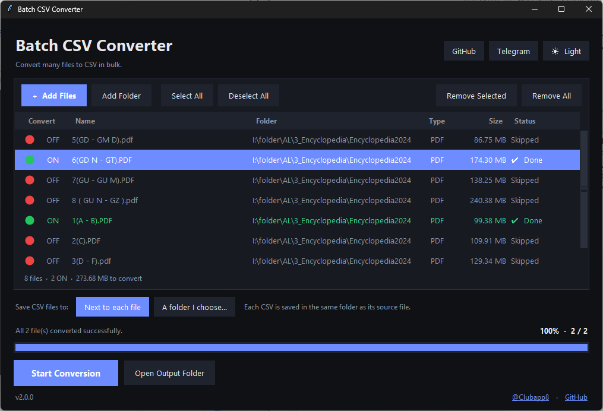

# Batch CSV Converter

**English** | [فارسی](#فارسی)

A modern Windows desktop tool that converts many files to CSV in one go.



## Features
- **Many formats → CSV:** Excel (`.xlsx .xlsm .xls`), CSV (re-standardised), TXT/LOG (auto delimiter + encoding detection), SQLite, Access (`.mdb .accdb`), SQL dumps (`INSERT` extraction), `.torrent` metadata, PDF (text per page), Word (`.docx`), and any other text-like file.
- **Drag & drop** files and folders into the window (Windows, no extra packages).
- **ON / OFF switch per file:** a green circle with the word ON means the file will be converted, a red circle with OFF means it is skipped. Click the circle (or press `Space`) to toggle.
- **Select All / Deselect All** buttons (`Ctrl+A` selects all), and **Remove All** to empty the list.
- Multi-process conversion with per-file status and overall progress.
- Dark / light theme, headless CLI mode.
- A file that can't be read is flagged as failed without stopping the rest.

**Output location:** by default each CSV is saved next to its source file. Use the *Save CSV files to* bar to choose one folder for all results instead (the choice is remembered). If two files would get the same name they become `name.csv`, `name (2).csv`, …

## Download
Grab `BatchCsvConverter_Portable_x64.exe` (no install) or `BatchCsvConverter_Setup_x64.exe` from the [Releases](https://github.com/Mrmmd2004/BatchCSVConverter/releases) page.

## How to use
1. Drag files or folders into the window (or use **Add Files** / **Add Folder**).
2. Switch off any file you don't want (red circle), or use **Select All** / **Deselect All**.
3. Press **Start Conversion**.
4. Press **Open Output Folder** to see the results.

## Run from source
```
pip install -r requirements.txt
python batch_csv_converter.py
```
CLI (no GUI): `python batch_csv_converter.py --cli file1.sql file2.xlsx` (add `--out C:\\results` to save everything in one folder)

## Build (Windows x64)
Needs 64-bit Python and [Inno Setup 6](https://jrsoftware.org/isinfo.php). Then run:
```
build.bat
```
Results appear in `release\`:
- `BatchCsvConverter_Portable_x64.exe` — single-file portable build
- `BatchCsvConverter_Setup_x64.exe` — installer

## Troubleshooting
Errors are logged to `%APPDATA%\BatchCsvConverter\crash.log`.

Links: [GitHub](https://github.com/Mrmmd2004/BatchCSVConverter) · [Telegram](https://t.me/Clubapp8)

---

<div dir="rtl">

## فارسی

ابزار دسکتاپ ویندوز برای تبدیل دسته‌ای چندین فایل به CSV، فقط با چند کلیک.

### امکانات
- **تبدیل فرمت‌های مختلف به CSV:** اکسل (`.xlsx .xlsm .xls`)، CSV، TXT/LOG (تشخیص خودکار جداکننده و انکودینگ)، SQLite، اکسس (`.mdb .accdb`)، دامپ SQL، متادیتای `.torrent`، PDF، ورد (`.docx`) و هر فایل متنی دیگر.
- **درگ و دراپ** فایل و پوشه داخل پنجره برنامه.
- **کلید روشن/خاموش برای هر فایل:** دایره **سبز** یعنی فایل تبدیل می‌شود، دایره **قرمز** یعنی نادیده گرفته می‌شود. با کلیک روی دایره (یا کلید `Space`) وضعیت عوض می‌شود.
- دکمه‌های **Select All** و **Deselect All** (کلید `Ctrl+A` هم همه را روشن می‌کند) و **Remove All** برای خالی کردن کل لیست.
- تبدیل چندپردازشی با نمایش وضعیت هر فایل و پیشرفت کلی.
- تم تیره و روشن، و حالت خط فرمان.
- اگر فایلی خوانده نشود فقط همان فایل «Failed» می‌شود و بقیه ادامه پیدا می‌کنند.

**محل خروجی:** به‌صورت پیش‌فرض هر CSV کنار فایل اصلی خودش ذخیره می‌شود. از نوار *Save CSV files to* می‌توانید یک پوشه دلخواه برای همه خروجی‌ها انتخاب کنید (انتخاب شما یادش می‌ماند). اگر دو فایل هم‌نام شوند به‌صورت `name (2).csv` و … ذخیره می‌شوند.

### دانلود
از بخش [Releases](https://github.com/Mrmmd2004/BatchCSVConverter/releases) فایل `BatchCsvConverter_Portable_x64.exe` (بدون نصب) یا `BatchCsvConverter_Setup_x64.exe` (نصب‌کننده) را دانلود کنید.

### طرز استفاده
1. فایل‌ها یا پوشه‌ها را داخل پنجره بکشید (یا از **Add Files** / **Add Folder** استفاده کنید).
2. فایل‌هایی که نمی‌خواهید را خاموش کنید (دایره قرمز) یا از **Select All** / **Deselect All** استفاده کنید.
3. روی **Start Conversion** بزنید.
4. با **Open Output Folder** پوشه خروجی را باز کنید.

### اجرا از سورس
```
pip install -r requirements.txt
python batch_csv_converter.py
```

### ساخت exe (ویندوز x64)
پایتون ۶۴ بیتی و [Inno Setup 6](https://jrsoftware.org/isinfo.php) لازم است. سپس `build.bat` را اجرا کنید. خروجی‌ها در پوشه `release\` ساخته می‌شوند.

### عیب‌یابی
خطاها در `%APPDATA%\BatchCsvConverter\crash.log` ذخیره می‌شوند.

لینک‌ها: [GitHub](https://github.com/Mrmmd2004/BatchCSVConverter) · [Telegram](https://t.me/Clubapp8)

</div>
